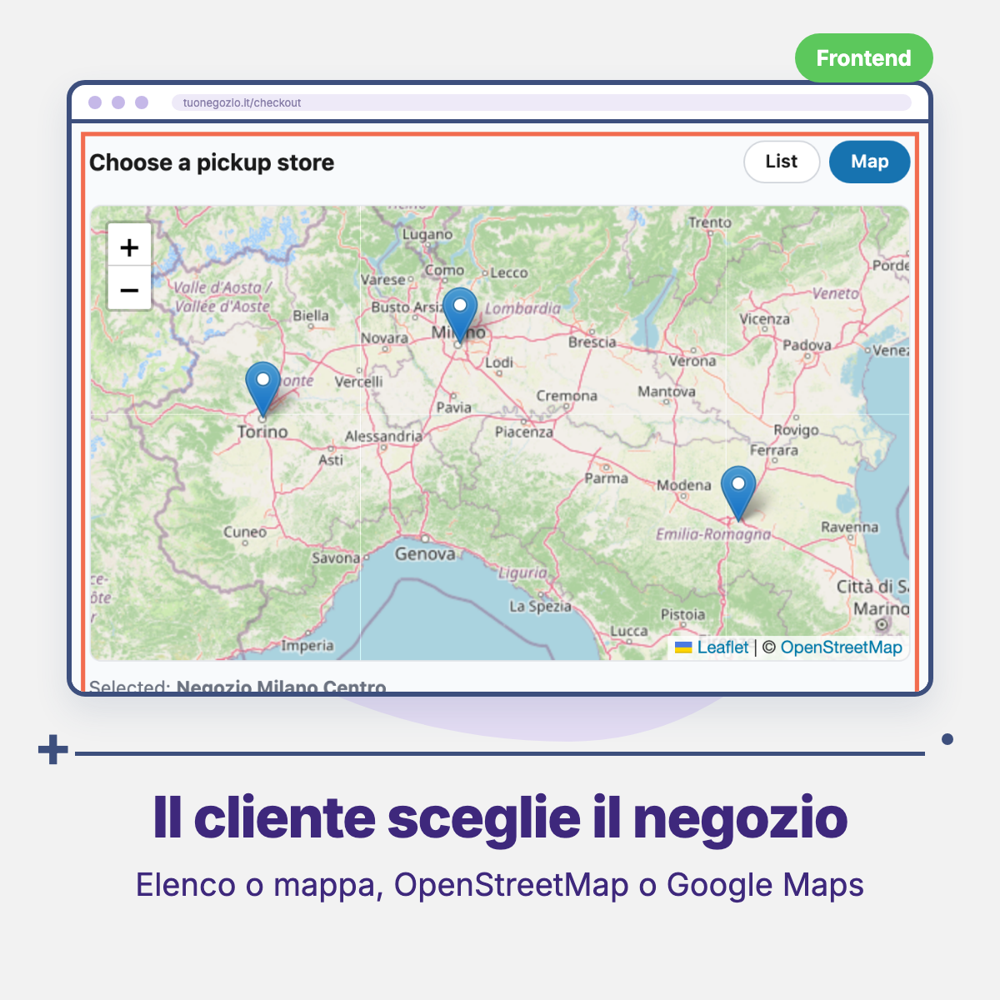
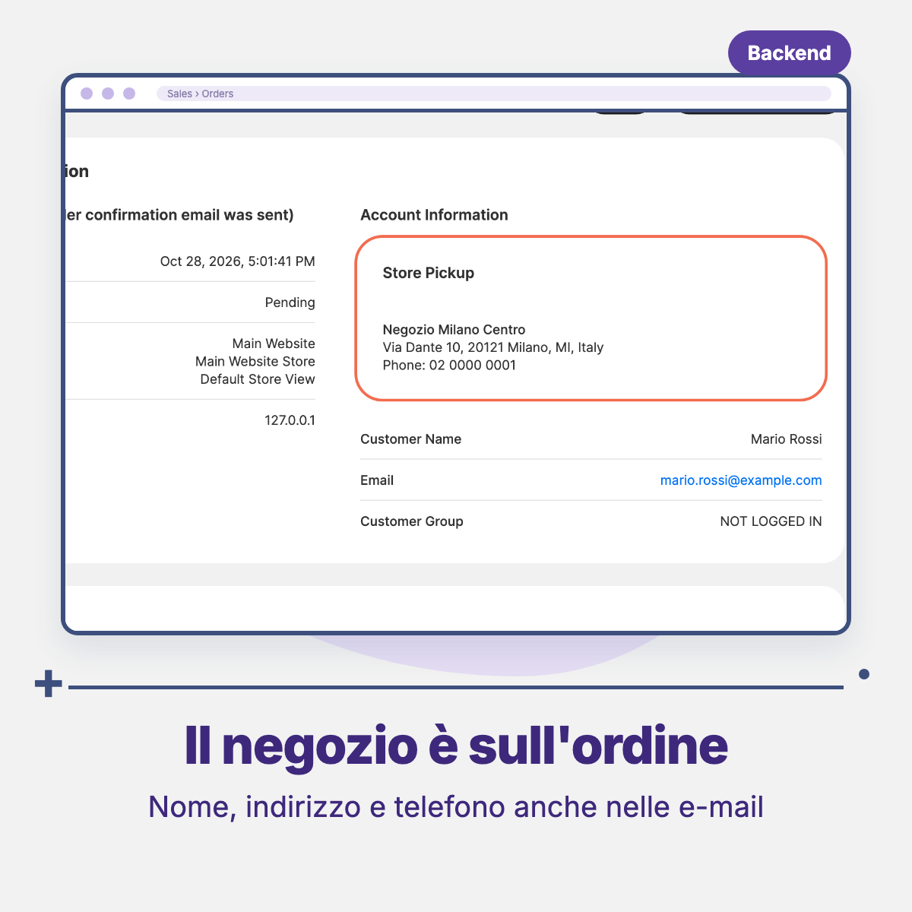

# Threecommerce_StorePickup: in-store pickup for Magento 2 / Mage-OS

An **in-store pickup** shipping method, built as an add-on to the Threecommerce Store Locator. At checkout the customer chooses the pickup store from a **list** or a **map** (Google Maps or OpenStreetMap, as set in the store locator). The chosen store appears in the checkout summary, on the thank-you page, in the admin order and in the order e-mails.

**Compatibility:** Magento Open Source / Adobe Commerce 2.4.4 – 2.4.9 · Mage-OS 1.x / 3.x · PHP 8.1 – 8.4 · Checkout themes: Breeze, Hyvä (with Threecommerce One Step Checkout)
**License:** commercial · coming soon

## Features

- Shipping method **Store Pickup** with configurable title, method name, handling fee (0 = free pickup) and allowed countries.
- Pickup is enabled **per store** from a *Store Pickup* tab in the store locator form, with a *Pickup* column in the store grid. Only active stores enabled for pickup and visible in the current store view are offered.
- **Map** follows the provider chosen in the store locator: Google Maps or OpenStreetMap (no key needed, Leaflet bundled in the store locator).
- The chosen store is saved on the quote and the order; the order cannot be placed without a valid store.
- At order placement the shipping address becomes the address of the store, so it shows in e-mails, grid and order.
- Store info in the admin order, invoice, shipment and credit memo, and on the thank-you page.
- The store locator is not modified: the module extends it additively.

## Requirements

- Magento Open Source / Adobe Commerce 2.4.4+ or Mage-OS
- PHP 8.1 – 8.4
- `threecommerce/m2-storelocator` ^1.2 (free, installed automatically by Composer)
- `threecommerce/m2-one-step-checkout` ^1.2 for the store picker at checkout (Breeze and Hyvä). With other checkouts the shipping method works but there is no store picker, so the order is blocked.
- With Google Maps: the API key configured in the store locator

## Availability

This module is **not yet available to buy**. It is a commercial product and is coming soon. To be notified when it is released, or to ask for details, use the [product page](https://www.threecommerce.it/ritiro-in-negozio-magento-2?utm_source=github&utm_medium=readme&utm_campaign=magento2-store-pickup) or [get in touch](https://www.threecommerce.it/contatti?utm_source=github&utm_medium=readme&utm_campaign=magento2-store-pickup).

## Configuration

- *Content → Store Locator → Stores*: edit a store and set **Store Pickup → Available for pickup** to Yes.
- *Stores → Configuration → Sales → Delivery Methods → Store Pickup (Threecommerce)*: enable, title, method name, handling fee, countries.
- Map provider, key and zoom: *Stores → Configuration → Threecommerce Plugins → Store Locator → Map Settings*.

## Documentation and support

- Product page: [threecommerce.it/ritiro-in-negozio-magento-2](https://www.threecommerce.it/ritiro-in-negozio-magento-2?utm_source=github&utm_medium=readme&utm_campaign=magento2-store-pickup)
- [Changelog](CHANGELOG.md)
- Support and custom development: [threecommerce.it/contatti](https://www.threecommerce.it/contatti?utm_source=github&utm_medium=readme&utm_campaign=magento2-store-pickup)

---

*This repository is the public showcase of the module. The source code is kept in a private repository.*
